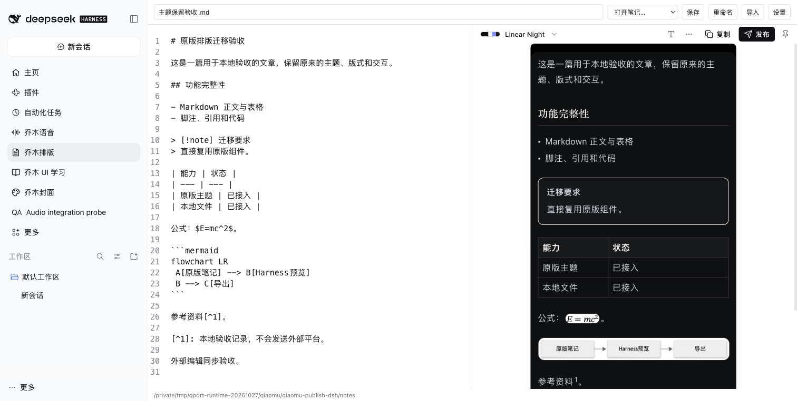

# Qiaomu Publish for DeepSeek Harness

> v0.1.2: DeepSeek Harness **0.2.1-rc.3** compatibility update. [Release verification](docs/RC3-COMPATIBILITY.md).

[中文](README.md)

Format Markdown for WeChat, X Articles, Zhihu and Xiaohongshu using the original Qiaomu Publish UI: live preview, 42 themes, per-note typography, cover design/cropping and publishing dialogs.



Includes Markdown files and attachments, draft recovery, conflict-aware saves, rename with retained styling, external file updates, wiki/note embeds, footnotes, tables, code, bundled MathJax/Mermaid image rendering, rich-text copy, standalone HTML and long PNG export. Six original Xiaohongshu card templates retain pagination, fonts, palettes, card removal, body and topic limits.

## Install

Requires DeepSeek Harness `0.2.1-rc.3` (`<0.3.0`) and Node.js 22+. Download the tgz and SHA256SUMS from [Releases](https://github.com/joeseesun/qiaomu-publish-dsh/releases), verify the digest, then install with the plugin manager or:

```sh
dsh plugin --profile desktop add /absolute/path/qiaomu-publish-dsh-0.1.2.tgz
```

Open Qiaomu Publish in the sidebar. Editing and exporting do not require publishing accounts.

## Files, settings and credentials

Notes default to `$DSH_HOME/qiaomu/qiaomu-publish-dsh/notes` (`~/.dsh` if DSH_HOME is unset). Optional absolute `notesDir` and `dataDir` plugin settings select another workspace. Saves and publishing metadata modify only notes in the selected workspace. Markdown limit: 2 MB; attachments: 32 MB; nested embeds: eight levels. Ambiguous or missing images block incomplete export.

Import original Publish or Qiaomu Agent `data.json` through Import. Themes, note styles, account configuration and credential IDs are preserved. Re-enter credentials in connection settings because the hosts use separate credential stores; the original Obsidian data and secrets are not removed. New secrets use macOS Keychain, Windows DPAPI or Linux Secret Service (`secret-tool` required), not configuration JSON.

## Publishing

Original multi-account WeChat direct/relay/self-hosted Bridge clients, draft creation/update, image/cover uploads and note metadata are retained. This plugin uses APIs; it does not automate the WeChat client. It creates drafts, not mass sends.

X, Zhihu and Xiaohongshu use [Qiaomu Clipper](https://github.com/joeseesun/qiaomu-clipper) and the user's logged-in browser. A temporary loopback listener serves one job using a one-time pickup token and session token, and closes on completion, cancellation, timeout or unload. Editing and previewing never submit content.

## Validation and development

Original business tests, native host boundary tests, build and package checks are included. macOS Harness QA covers original UI, math/diagram images, HTML/PNG export, rename, external edits, publishing dialogs and real PNG generation for all six card templates. Live account submission was not performed; API fixtures and real loopback tests do not establish platform account acceptance. Windows/Linux credential backends are implemented but not device-tested here. See [adaptation evidence](docs/ADAPTATION.md).

```sh
npm ci
npm run check
npm pack
```

`node scripts/qa-cards.mjs` builds the local card export harness in `build/cards-qa`.

MIT. Adapted from [qiaomu-publish](https://github.com/joeseesun/qiaomu-publish), commit `4fbeae30017e1db4be95b7454620b30eae47ada8`. Product CSS is unchanged; native boundaries and dark-content readability fixes are documented. See [dependency/font notices](THIRD_PARTY_NOTICES.md).
