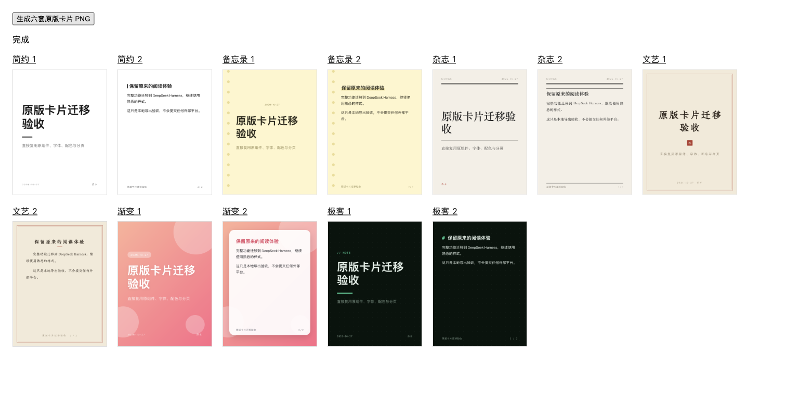

# 乔木 Publish · DeepSeek Harness

> v0.1.1：DeepSeek Harness **0.2.1-rc.3** 兼容更新。[本次验证范围](docs/RC3-COMPATIBILITY.md)。

[English](README.en.md)

把 Markdown 笔记排成公众号文章、X 文章、知乎草稿和小红书图文。直接复用原版 Qiaomu Publish 的预览、42 个主题、排版控件、封面编辑与发布窗口。


## 功能

- 原版实时预览、双向滚动、主题搜索与逐篇排版；字号、字体、行距、段距、主色、缩进、代码样式等沿用原控件。
- Markdown 文件、草稿恢复、附件导入、重命名保留主题、外部修改同步。保存会检查文件版本，避免覆盖其他编辑器的修改。
- 表格、提示块、脚注、代码、Wiki/Markdown 图片与笔记嵌入；内置 MathJax 和 Mermaid，公式与图表可随正文导出为图片。
- 复制公众号富文本、独立 HTML、长图 PNG；标题封面、图片选择、裁剪与字体配色直接沿用原版。
- 公众号多账号、直连／固定 IP 中转／自建 Bridge、新建和更新草稿、上传图片与封面、发布前检查、笔记属性记录。
- X／知乎／小红书沿用 Qiaomu Clipper v1 本机交接。六套小红书模板、分页、配色、字体、移除卡片、正文与话题限制均保留。



## 安装

要求 DeepSeek Harness `0.2.1-rc.3`，Node.js 22 或更新版本。

1. 从 [Releases](https://github.com/joeseesun/qiaomu-publish-dsh/releases) 下载 tgz 和 SHA256SUMS，核对摘要。
2. 在 Harness 插件管理安装本地 tgz，或执行：

```sh
dsh plugin --profile desktop add /absolute/path/qiaomu-publish-dsh-0.1.1.tgz
```

打开侧栏「乔木排版」。不需要连接任何发布账号即可编辑、排版和导出。

## 笔记和原配置迁移

默认工作目录为 `$DSH_HOME/qiaomu/qiaomu-publish-dsh/notes`，未设置 DSH_HOME 时使用 `~/.dsh`。在该目录保存 Markdown 和附件，或通过「导入」选择文件。目录内相对图片路径保持不变；单篇 Markdown 上限 2 MB，单个附件上限 32 MB。

插件配置可指定 `notesDir`、`dataDir` 的绝对路径。选择已有笔记目录后，保存和发布记录会写入所选笔记；未选择的原 Obsidian 仓库不会修改。嵌入最多 8 层，同名附件无法唯一确定时明确报缺图，阻止不完整导出。

「导入」支持原 Publish 或乔木 Agent 的 `data.json`，保留主题、逐篇样式、账号配置与凭据 ID。不同宿主的凭据库不能直接共享，请在原版连接设置中重新填写 AppSecret／令牌；原 Obsidian 凭据不会删除。新凭据使用 macOS Keychain、Windows DPAPI 或 Linux Secret Service，配置 JSON 不保存密钥。Linux 需要可用的 `secret-tool` 和 Secret Service。

## 发布到平台

公众号窗口使用官方 API或用户配置的中转服务；不操作微信客户端或微信内嵌页面。发布按钮只创建／更新草稿，不直接群发。

X、知乎、小红书需要已安装 [Qiaomu Clipper](https://github.com/joeseesun/qiaomu-clipper)，并在目标浏览器登录平台。交接时 Host 临时监听 `127.0.0.1` 随机端口，使用一次性取件令牌和会话令牌，完成、取消、超时或卸载后关闭。不会在编辑或预览时自动发送内容。

## 验证范围

构建、包契约、原版业务逻辑及宿主边界均有测试。macOS 上已在独立 Harness profile 实测原版预览、公式／图表图片、HTML／长图导出、重命名、外部同步、发布窗口和六套卡片 PNG。

公众号真实账号和外部平台草稿发送没有在迁移验收中执行；传输与交接使用 fixture 和真实本机 socket 检查，不能替代真实账号验收。Windows/Linux 凭据实现尚未在对应系统实机验证。逐项记录见 [ADAPTATION](docs/ADAPTATION.md)。

## 开发

```sh
npm ci
npm run check
npm pack
```

浏览器卡片验收页：`node scripts/qa-cards.mjs`，随后在 `build/cards-qa` 启动本地静态服务器。

MIT。原始代码来自 [qiaomu-publish](https://github.com/joeseesun/qiaomu-publish) 的 `4fbeae30017e1db4be95b7454620b30eae47ada8`。产品 CSS 保持字节一致；宿主边界与两项深色可读性修复有记录。依赖与字体许可证见 [THIRD_PARTY_NOTICES.md](THIRD_PARTY_NOTICES.md)。
